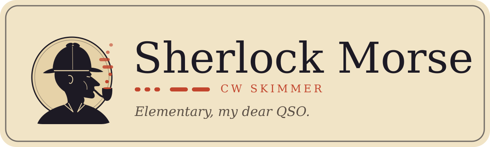

<p align="center"></p>

# Sherlock Morse

A CW (Morse code) skimmer for Linux. It finds **every CW signal in your receiver's audio
passband**, decodes them all at the same time, pulls out callsigns, and can
retune your radio over CAT with a click.

Runs on Linux as a single native binary, no runtime needed. It has only been
tested on Linux so far.

## Features

- **Decodes the whole passband at once.** A spectrum detector finds keyed
  carriers (it ignores steady carriers and birdies) and starts an
  independent decoder on each one. A 1.5 s audio pre-roll means the first
  characters of a transmission aren't lost.
- **Probabilistic decoder.** Dots and dashes are never perfect, so nothing is
  decided by fixed thresholds:
  - Element timing is scored with log-normal likelihoods. The speed comes from
    a robust maximum-likelihood search and is then tracked adaptively, which
    handles hand-key "fists", odd weighting, Farnsworth spacing and speed drift.
  - A **beam search** keeps dozens of competing interpretations alive. It
    includes hypotheses that a mark was a static crash, that a gap was a
    QSB dropout in the middle of a dash, and that a gap hides a dit too
    faded to cross the threshold.
  - **Soft decisions:** every mark and gap carries its amplitude evidence,
    so those hypotheses are cheap when the envelope was ambiguous and
    expensive when it was clear.
  - Each sender's **word spacing** is learned from their gaps, so operators
    who run words together or spread letters apart are followed.
  - A **character 5-gram language model** of amateur traffic (QSOs, contest
    exchanges, callsigns, plain English), trained on built-in text in
    `data/corpus/`, picks the most plausible text. Text is only committed
    once all surviving hypotheses agree on it. Run-together `BK` is
    recognised.
- **Waterfall** with callsign labels on each signal. Click a signal to follow
  it; double-click or right-click to tune the radio to it; the mouse wheel
  tunes ±50 Hz.
- **Spots list** of callsigns heard (after `DE`/`CQ`, or seen twice), with RF
  frequency, speed and SNR. Click a spot's frequency to tune to it. Calls
  need a valid DXCC prefix; calls heard only once are dimmed until
  confirmed. A near miss of a call already confirmed on that signal (a dit
  lost in a fade, e.g. T8AE for N8AE) is corrected to that call.
- **Country of every spot**, from AD1C's `cty.dat` (the file loggers use),
  built in so it works offline. Hover a spot's country for continent, CQ/ITU
  zone, local time and beam heading. Portable calls are handled (`DL/W1ABC`,
  `W1ABC/KH6`, `UA9ABC/1`). Settings → Country file → **Update** downloads
  the latest copy.
- **Station info.** Click any callsign (spots, decoder list, decoded text)
  for a popup with name, address, grid, distance and beam heading, and photo,
  plus buttons to open the call on QRZ.com or HamQTH. US and Canadian calls
  need no account (HamDB). A free QRZ.com login adds name and country for any
  call, and a free HamQTH.com login adds worldwide data and photos. Set the
  logins and your own grid in Settings.
- **Decoders follow the radio.** When you QSY, decoders move with their
  signals in the passband instead of being lost.
- **Sound card selection with auto-detect.** The radio's USB audio codec
  (Yaesu/Icom/Kenwood "USB Audio CODEC", SignaLink, Digirig, CM108…) is
  picked automatically. Any input works (USB, line-in, microphone), and you
  can use the left, right or mixed channel.
- **CAT control for many radios**:
  | Protocol | Radios |
  |---|---|
  | Yaesu CAT | **FTDX3000**, FTDX5000, FTDX1200, FT-950, FT-2000, FT-991/A, FT-891, FT-710, FTDX10, FTDX101 |
  | Kenwood / Elecraft | TS-480, TS-590S/SG, TS-890, TS-990, TS-2000, K3, K4, KX2, KX3 |
  | Icom CI-V | IC-7300, IC-7610, IC-705, IC-9700, IC-7100, IC-7410, IC-7600, IC-7760 … |
  | Yaesu legacy | FT-817/818, FT-857, FT-897 |
  | Hamlib `rigctld` | anything Hamlib supports (hundreds of radios) |

  **Auto-detect** probes USB serial ports, identifies the radio model (for
  example `ID0462;` means FTDX3000), and picks the right protocol and baud
  rate.
- **Audio files** (WAV/MP3/FLAC/OGG/M4A) can be played through the skimmer
  for practice or testing.

## Yaesu FTDX3000 setup

1. Connect the radio's rear **USB** port to the computer. That one cable
   carries both the sound card and the CAT port.
   - You get `/dev/ttyUSB0` (Enhanced/CAT) and `/dev/ttyUSB1`.
     Add yourself to the `dialout` group (`sudo usermod -aG dialout $USER`,
     then log out and back in).
2. Radio menus (press and hold MENU):
   - **CAT RATE**: 38400 (the default is 4800; any rate works, as long as the
     program uses the same one).
   - **CAT RTS**: **OFF**. The program keeps RTS and DTR low on every
     port so it can never key the transmitter. With CAT RTS on, the radio
     would wait for RTS and ignore CAT commands.
   - Use only the **Enhanced** port (`/dev/ttyUSB0`) for CAT. The Standard
     port (`/dev/ttyUSB1`) can key PTT/CW through RTS/DTR. The program
     labels it, refuses to connect to it, and auto-detect never probes it.
   - **CW PITCH**: note the value (default 700 Hz) and enter it under
     ⚙ Settings → CW pitch so that click-to-tune lands signals exactly.
   - USB audio output level (**USB OUT LEVEL** in the CW/DATA menus) about
     50, so the input meter peaks well below 0 dBFS.
3. In the program, under **Radio**, choose *Yaesu CAT*, select the port, set
   38400, and press **Connect**. Or just press **Auto-detect**.
4. Under **Audio**, press **Auto**. The radio's "USB Audio CODEC" is
   selected automatically.
5. Put the radio in CW with a wide filter (2.4–3 kHz) so the skimmer sees
   the whole passband.

## Building

Install Rust from <https://rustup.rs>, then:

```bash
# system libraries
sudo apt install build-essential pkg-config libasound2-dev libudev-dev libxkbcommon-dev libwayland-dev libgl1-mesa-dev

cargo build --release
./target/release/cwskimmer
```

## Command-line tool

`cwtool` handles testing and scripting:

```bash
cwtool devices                      # list sound cards (★ = detected radio)
cwtool ports                        # list serial ports
cwtool probe                        # auto-detect radios on USB serial
cwtool rig --kind yaesu --port /dev/ttyUSB0 --baud 38400            # read VFO
cwtool rig --kind yaesu --port /dev/ttyUSB0 --set 14025000          # QSY
cwtool decode recording.mp3         # decode every signal in a recording
cwtool decode w1aw.mp3 --reference w1aw.txt   # measure character error rate
cwtool synth --pileup -o band.wav   # generate a 6-station test scene
cwtool bench --compare-lm           # synthetic benchmark suite
cwtool cty DL/W1ABC VP8LP           # DXCC country, zones and position of calls
```

## How well it decodes

`cwtool bench` runs the full skimmer (detection plus decoding) on synthetic
signals with realistic impairments. The score is character error rate
(Levenshtein distance), averaged over 24 trials; SNR is measured in a
2500 Hz bandwidth. "Rayleigh" scenarios use random multipath fading like
real skywave QSB (deep, irregular fades), not a slow sine.

| Scenario | CER |
|---|---|
| Clean, 20 WPM | 0.0 % |
| SNR +5 dB, 25 WPM | 0.2 % |
| SNR 0 dB, 22 WPM | 0.6 % |
| SNR −4 dB, 18 WPM | 2.0 % |
| SNR −8 dB, 18 WPM | 21 % |
| Hand key, 15 % timing jitter | 0.2 % |
| Bad fist: 25 % jitter, 3.8:1 dashes, heavy weighting | 11 % |
| Farnsworth 18/8 WPM | 5.1 % |
| Deep periodic QSB | 1.3 % |
| Rayleigh fading, SNR 0 dB, 16 WPM, 1 Hz | 5.2 % |
| Rayleigh fading, SNR −3 dB, 20 WPM | 3.7 % |
| Rayleigh fading + hand key | 0.8 % |
| Words run together (4.5-dot word gaps) | 1.6 % |
| Letters spread apart (4.5-dot character gaps) | 0.3 % |
| Static crashes (QRN) | 0.6 % |
| Speed drifting +40 % | 0.0 % |
| 40 WPM / 10 WPM | 0.0 % / 0.0 % |
| Random 5-letter groups (LM can't help) | 1.5 % |
| 5-station pileup, 80–240 Hz apart | 1.9 % |

Turning the language model off (`--compare-lm`) raises the error rate on clean
signals from about 0 % to about 20 %, so the text prediction matters. At
−8 dB most output is suppressed as noise rather than shown as garbage.

### Real recordings

| Recording | Result |
|---|---|
| ARRL W1AW code practice, 15 WPM (published transcript) | 1.8 % CER |
| ARRL W1AW code practice, 20 WPM | 0.0 % CER |
| ARRL W1AW code practice, 25 WPM | 0.0 % CER |
| DARC "Morse class on the air" (real HF reception, several stations) | main text copied, e.g. "…NASAL BONES WERE A UNIQUE FEATURE OF TYRANNOSAURIDS…"; some noise channels remain in the hiss |

W1AW files come from <https://www.arrl.org/code-practice-files>. To check
them yourself, run `cwtool decode <mp3> --reference <txt>`.

### Noise and artifact handling

- Key clicks, harmonics and codec noise around very strong signals are
  detected (their keying correlates with the strong signal) and removed.
- Long broadband static crashes are treated as erasures, not as keying.
- A channel only shows text once it looks like Morse rather than noise:
  enough elements per character and enough dashes, since noise decodes as
  E/I/S/H. Text the language model finds implausible is shown dimmed;
  only text that is both implausible and made of short characters (the
  signature of noise) is hidden, so weak real signals and code groups stay
  visible.
- Two channels of similar strength close together that key in step are
  the same signal picked up twice; the weaker one is dropped.
- A station that pauses and comes back on the same frequency continues in
  the same row.

## Architecture

```
sound card / file ─► resampler (8 kHz) ─► FFT 512 ─► waterfall + signal detector
                                     │
                                     └─► per signal: mixer ─► 4th-order LPF (matched to speed, AFC)
                                              ─► envelope ─► adaptive slicer ─► mark/space runs + amplitude evidence
                                              ─► timing model + beam search + 5-gram LM ─► text ─► callsigns
```

| Module | Purpose |
|---|---|
| `src/decoder.rs` | slicer, timing model, beam-search decoder |
| `src/lm.rs` | 5-gram language model (trained at start-up from `data/corpus/` and a generated corpus) |
| `src/cty.rs` | DXCC country lookup from `data/cty.dat` |
| `src/skimmer.rs` | signal detection, channel lifecycle, spots |
| `src/dsp/` | resampler, channel demodulator, spectrum |
| `src/cat/` | radio protocols, auto-detect, polling thread |
| `src/audio.rs` | sound card capture and auto-selection |
| `src/synth.rs` | impaired-CW synthesizer used by tests and the benchmark |
| `src/main.rs` | egui user interface |

## License

Copyright (C) 2026 NR5P

Sherlock Morse is free software: you can redistribute it and/or modify it
under the terms of the [GNU General Public License](LICENSE) as published by
the Free Software Foundation, either version 3 of the License, or (at your
option) any later version.
